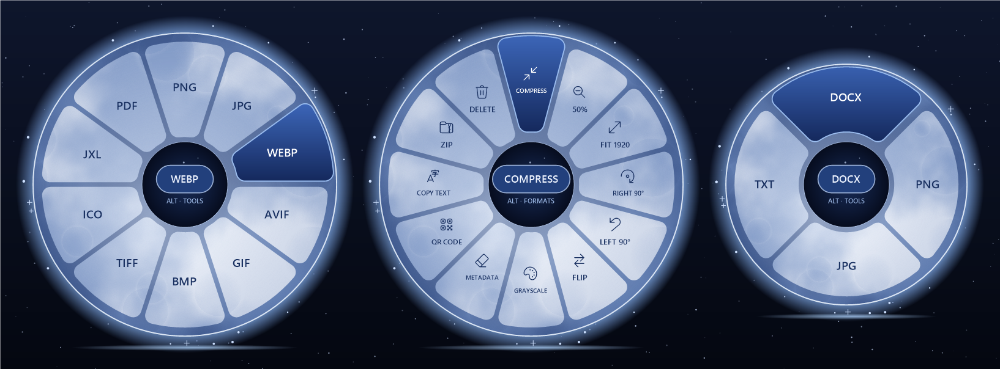
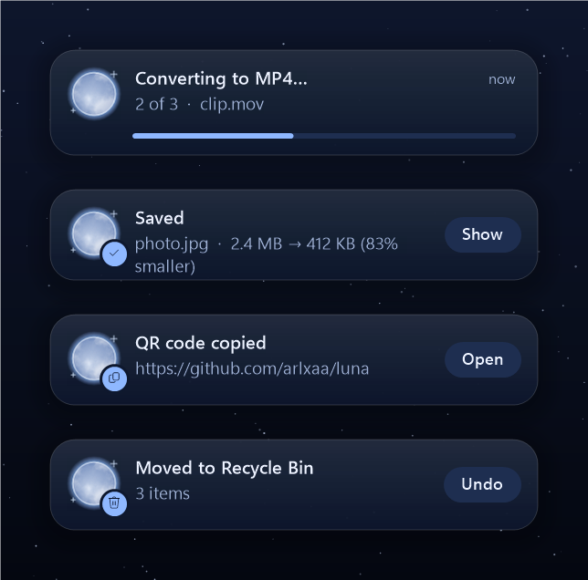

<p align="center">
  
</p>

<h1 align="center">Luna</h1>

<p align="center">
  <b>Drag a file, press Shift, drop it on a format.</b><br>
  A tiny file converter for Windows that lives under your cursor. Offline, free, no windows to open.
</p>

<p align="center">
  <a href="https://github.com/arlxaa/luna/actions/workflows/build.yml"></a>
  
  
  
</p>

<p align="center">
  
</p>

Start dragging any file in File Explorer or on the desktop, press **Shift**, and a ring of formats
opens around your cursor. Drop the file on a slice: the converted copy appears next to the original.
Hold **Alt** to switch the ring to tools such as compress, remove metadata, read a QR code, copy text, or delete.

Luna is a Windows take on [Tangerine](https://www.macg.co/logiciels/2026/10/tangerine-un-convertisseur-de-fichiers-toujours-portee-de-main-sur-mac-311381),
a macOS app by Thameem Hassan. It is an independent project written from scratch and is not
affiliated with Tangerine.

## Contents

- [Install](#install)
- [Using Luna](#using-luna)
- [What it converts](#what-it-converts)
- [Engines](#engines)
- [Privacy](#privacy)
- [Settings and uninstalling](#settings-and-uninstalling)
- [Building from source](#building-from-source)
- [How it works](#how-it-works)
- [Credits](#credits)

## Install

1. Download from the [latest release](https://github.com/arlxaa/luna/releases/latest):
   - **`Luna.exe`** (about 1 MB) needs the [.NET 10 Desktop Runtime](https://dotnet.microsoft.com/download/dotnet/10.0).
     Windows offers to download it the first time if it is missing.
   - **`Luna-standalone.exe`** (about 50 MB) runs without installing anything.
2. Put it somewhere permanent, for example `%LOCALAPPDATA%\Programs\Luna\Luna.exe`, and run it.
3. A moon appears in the system tray. On first run Luna adds itself to login items and to the
   Explorer right-click menu; both can be turned off from the tray menu.
4. For images, video and audio, install FFmpeg once: `winget install Gyan.FFmpeg`.

There is no installer. Luna writes only per-user settings, so it never asks for admin rights.

## Using Luna

| Gesture | What happens |
|---|---|
| Start dragging a file, then press **Shift** | The ring opens under the cursor. Drop on a slice to convert. |
| Hold **Alt** while the ring is open | Switches between the **Formats** ring and the **Tools** ring. |
| Drop on the center | Keeps the ring open so you can click instead. |
| Right-click → *Show more options* → **Convert with Luna** | Opens the ring for the selected files. Use the mouse, or arrow keys + Enter. **Tab** switches rings, **Esc** closes. |
| Drop several files at once | Each file is converted; tools such as *Combine into PDF*, *Merge PDFs* and *Zip* use them together. |

Press Shift *after* the drag has started: Shift+click in Explorer selects a range of files.
The trigger key can be changed to Alt or Ctrl+Shift in the tray menu.

Results always go into new files next to the original (`photo.heic` → `photo.jpg`,
`report.pdf` → `report (compressed).pdf`). Nothing is ever overwritten.

**Delete** (the red slice) moves the files to the Recycle Bin, and the notification has an **Undo**
button that puts them back where they were. Luna never deletes anything permanently on its own: if an
item can't go to the Recycle Bin (for example on a network drive), Windows asks first.

<p align="center">
  
</p>

A notification in the top-right corner shows progress and the result. Click it to reveal the file
in Explorer. QR codes and recognized text are copied to the clipboard.

## What it converts

| Files | Convert to | Tools |
|---|---|---|
| **Images**: PNG, JPG, HEIC, WebP, AVIF, GIF, BMP, TIFF, ICO, JXL, PSD, TGA | PNG · JPG · WebP · AVIF · GIF · BMP · TIFF · ICO (multi-size) · JXL · PDF | Compress · Resize 50% · Fit 1920 px · Rotate · Flip · Grayscale · Remove metadata · Read QR code · Copy text (OCR) · Combine into PDF · Zip · Delete |
| **Video**: MP4, MOV, MKV, WebM, AVI, WMV, … | MP4 · MOV · MKV · WebM · AVI · GIF · MP3 · M4A · WAV | Compress · 720p · Rotate · Mute · Thumbnail · Remove metadata · Zip · Delete |
| **Audio**: MP3, WAV, FLAC, M4A, OGG, Opus, … | MP3 · M4A · WAV · FLAC · OGG · Opus · AIFF | Normalize volume · Trim silence · Mono · Remove metadata · Zip · Delete |
| **PDF** | DOCX · PNG · JPG · TXT | Merge · Split pages · Compress · Rotate · Remove restrictions · Zip · Delete |
| **Word**: DOC, DOCX, RTF, ODT | PDF · DOCX · DOC · ODT · RTF · TXT · HTML | Remove metadata · Zip · Delete |
| **Excel**: XLS, XLSX, ODS, CSV | PDF · XLSX · XLS · CSV · ODS | Remove metadata · Zip · Delete |
| **PowerPoint**: PPT, PPTX, ODP | PDF · PPTX · PPT · ODP · PNG/JPG per slide · MP4 video | Remove metadata · Zip · Delete |
| **Markdown, HTML, TXT** | HTML · PDF · DOCX · TXT | Zip · Delete |
| **Archives**: ZIP, 7Z, RAR, TAR.GZ, ISO, … | ZIP · 7Z · TAR.GZ | Extract here · Delete |
| **Folders** and other files | ZIP · 7Z · TAR.GZ | Delete |

A few details:
- Video conversions copy the streams without re-encoding when the target container allows it, so they are instant and lossless.
- Removing metadata from JPEG, PNG and WebP rewrites only the file container, so the pixels are untouched. The JPEG orientation is kept, so photos don't flip.
- Extracting an archive with a single top-level folder puts that folder next to the archive instead of nesting it.

## Engines

Luna bundles nothing. It drives tools that are already on your PC. A slice whose engine is missing
is dimmed (the center reads, for example, *GET QPDF*), and choosing it offers to install the engine.

| Engine | Used for | How to get it |
|---|---|---|
| [FFmpeg](https://ffmpeg.org) | images, video, audio, QR codes | `winget install Gyan.FFmpeg` |
| Microsoft Office | Word, Excel and PowerPoint conversions, PDF → DOCX | already installed, or skip these formats |
| Windows (built in) | PDF → images, OCR, archives (`tar.exe`), HTML/Markdown → PDF (Edge) | always available |
| [qpdf](https://qpdf.sourceforge.io) | merge, split, rotate, unlock and compress PDFs | Luna offers to install it with winget the first time you use one of these |
| [Ghostscript](https://ghostscript.com) (optional) | stronger PDF compression; used automatically when installed | ghostscript.com |

The tray menu → **Engines** shows what is installed.

## Privacy

Everything runs on your PC. Luna has no telemetry, no accounts and makes no network requests.
The only time anything is downloaded is when you click **Install** for a missing engine, which runs `winget`.

## Settings and uninstalling

Click the moon in the tray for the menu:

- **Shift-drag menu**: turn the gesture on or off.
- **Trigger key**: Shift, Alt or Ctrl+Shift.
- **Only from File Explorer & Desktop**: when unticked, the gesture works in any app.
- **Right-click menu entry** and **Open at login**.
- **Engines**, **How to use**, **About Luna**, **Uninstall Luna…** and **Quit Luna**.

Luna stores and changes only these:

| What | Where |
|---|---|
| Settings | `%APPDATA%\Luna\settings.json` |
| Login item | `HKCU\Software\Microsoft\Windows\CurrentVersion\Run` → `Luna` |
| Right-click entry | `HKCU\Software\Classes\*\shell\Luna` and `HKCU\Software\Classes\Directory\shell\Luna` |
| Word option (only when converting a PDF with Word) | `DisableConvertPdfWarning` under `HKCU\Software\Microsoft\Office\<version>\Word\Options`, which is the same as ticking "Don't show this message again" on Word's PDF prompt |

**Uninstall Luna…** in the tray menu removes the login item, the right-click entry and the settings,
quits, and shows `Luna.exe` in Explorer so you can delete it.

## Building from source

You need Windows 10 or 11 and the [.NET 10 SDK](https://dotnet.microsoft.com/download/dotnet/10.0).

```powershell
git clone https://github.com/arlxaa/luna
cd luna
dotnet build Luna.slnx -c Release
dotnet publish src/Luna/Luna.csproj -c Release -r win-x64 -o publish   # → publish\Luna.exe
```

The developer tools project has three commands:

```powershell
# Create sample files and run every menu action on them (needs FFmpeg; Office/qpdf optional)
dotnet run --project tools/Luna.DevTools -c Release -- smoke $env:TEMP\luna-smoke

# Re-render the README images in docs/images (drawn off-screen, nothing from your desktop)
dotnet run --project tools/Luna.DevTools -c Release -- screenshots docs/images

# Regenerate the app icon
dotnet run --project tools/Luna.DevTools -c Release -- icon src/Luna/Assets
```

To release, push a tag such as `v1.0.0`. The **Release** workflow builds `Luna.exe` and
`Luna-standalone.exe` and attaches them to a GitHub release.

### Project layout

```
src/Luna/
  Program.cs, TrayApp.cs   entry point, single instance, tray menu
  MouseHook.cs             low-level mouse hook that spots the Shift-drag
  Catalog.cs               which formats and tools each file type gets
  Jobs.cs                  background job queue (STA thread for Office) and output naming
  Engines/                 FFmpeg, Office (late-bound COM), WinRT (PDF + OCR), process runner
  Ops/                     the conversions: images, media, documents, PDF, archives, metadata
  UI/                      ring menu, notifications, tray menu style, moon texture, theme
tools/Luna.DevTools/       icon generator, README screenshots, smoke test
```

## How it works

- **Gesture**: a low-level mouse hook, running on its own thread so the cursor never lags, notices a
  left-button drag that started in Explorer with the trigger key held. Luna then places an invisible
  drop target under the cursor. The ring only appears once real files are dragged over it, so
  rubber-band selections never flash a menu. Luna answers the drop as *copy*, never *move*,
  so Explorer can't delete the original.
- **Ring**: drawn with GDI+ into a per-pixel-alpha layered window. The moon surface is procedural
  value noise with craters, baked once per size, so no image assets are needed.
- **PDF and OCR** use the built-in `Windows.Data.Pdf` and `Windows.Media.Ocr` APIs, called through raw
  WinRT vtables instead of the 25 MB SDK projection. This keeps Luna to one small exe with no NuGet dependencies.
- **Office** is automated through late-bound COM on an STA thread. Macros are disabled, protected files
  fail fast instead of showing hidden prompts, and an Office window you already have open is never closed.
- **Right-click**: Explorer launches one process per selected file. Each one forwards its path to the
  running instance through a named pipe, and Luna gathers them into a single menu.

## Credits

- The idea and the ring interaction come from [Tangerine](https://www.macg.co/logiciels/2026/10/tangerine-un-convertisseur-de-fichiers-toujours-portee-de-main-sur-mac-311381) by Thameem Hassan.
- The moon theme was inspired by a moon illustration. All visuals here are generated by code.
- Conversions are done by FFmpeg, Microsoft Office, qpdf, Ghostscript, libarchive (Windows `tar`) and Windows itself.

This project does not include a license file yet.
